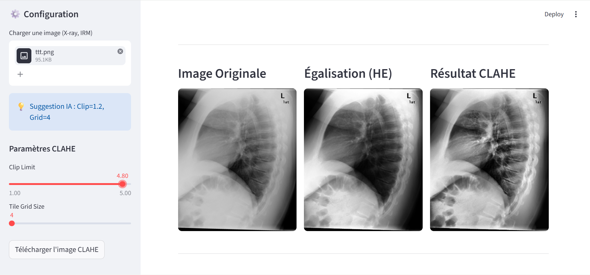
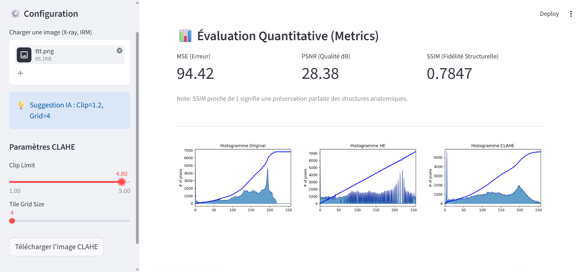

# 🔬 Amélioration d'Images Médicales avec CLAHE

> **Application Interactive sous Python & Streamlit pour l'amélioration du contraste des images médicales avec Évaluation Quantitative (MSE, PSNR, SSIM)**

---

## 📌 Présentation du Projet

Cette application interactive permet d’améliorer le contraste d’images médicales (telles que les radiographies, IRM ou scanners) en comparant plusieurs techniques de traitement d’image :
- **Égalisation d’histogramme classique (HE)**
- **CLAHE** (*Contrast Limited Adaptive Histogram Equalization*)

L’objectif principal est d’obtenir une meilleure visibilité des détails anatomiques tout en limitant l’amplification du bruit, grâce notamment à une **suggestion automatique intelligente (Smart CLAHE)**.

---
## 📸 Aperçu de l'Application

### 🖥️ Interface & Comparaison des Résultats
| Interface & Configuration | Résultats (Original vs HE vs CLAHE) |
| :---: | :---: |
|  |  |


## 🌟 Fonctionnalités Principales

* **🖥️ Interface Web Interactive (Streamlit) :** Permet de charger des images médicales et de régler dynamiquement les paramètres en temps réel.
* **💡 Suggestion Intelligente (IA) :** Analyse statistique de l'image (écart-type) pour recommander les valeurs optimales de *Clip Limit* et de *Tile Grid Size*.
* **📊 Évaluation Quantitative Avancée :** Calcul instantané de trois métriques clés :
  * **MSE** (Erreur Quadratique Moyenne)
  * **PSNR** (Rapport Signal sur Bruit de Crête en dB)
  * **SSIM** (Fidélité et Similarité Structurelle)
* **📈 Visualisation Graphique :** Affichage des histogrammes de distribution des pixels avec superposition de la courbe cumulative (CDF).
* **💾 Exportation du Résultat :** Téléchargement direct de l'image traitée.

---

## 🛠️ Technologies & Bibliothèques Utilisées

| Technologie / Librairie | Rôle Principal |
| :--- | :--- |
| **Python** | Langage de programmation principal |
| **Streamlit** | Création de l'interface utilisateur web |
| **OpenCV (`cv2`)** | Traitement d'images et application des filtres HE/CLAHE |
| **NumPy & Matplotlib** | Calculs numériques et tracés des histogrammes |
| **scikit-image** | Calcul précis du score de similarité structurelle (SSIM) |

---

## 📂 Structure du Projet

* Des exemples d'images médicales pour les tests sont disponibles dans le dossier `image_pour_test/`.

---

## ⚙️ Installation et Exécution

1. **Installer les bibliothèques nécessaires avec :**
   ```bash
   pip install streamlit opencv-python numpy matplotlib scikit-image
2.
Lancer le projet avec la commande suivante :

streamlit run code.py
